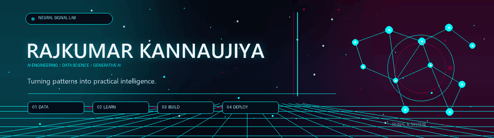
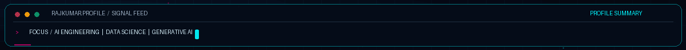
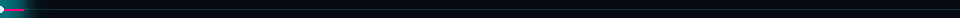
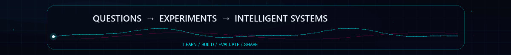

  
  
  
  

📍 Surat, Gujarat, India &nbsp;·&nbsp; 🎓 B.S. Data Science &amp; Applications @ IIT Madras (2024–2026)

<table>
  <tr>
    <td align="center" width="25%">
      <h3>🧠 PRIMARY TRACK</h3>
      <b>AI &amp; Machine Learning</b> 
      Deep Learning · GenAI · LLMs
    </td>
    <td align="center" width="25%">
      <h3>🎓 EDUCATION</h3>
      <b>IIT Madras</b> 
      Data Science &amp; Applications · 2024–26
    </td>
    <td align="center" width="25%">
      <h3>📊 DATA PRACTICE</h3>
      <b>Python · SQL · Statistics</b> 
      Analysis · Modeling · Visualization
    </td>
    <td align="center" width="25%">
      <h3>🚀 MODEL DELIVERY</h3>
      <b>FastAPI · Docker · AWS</b> 
      From experiment to usable tool
    </td>
  </tr>
</table>

<table>
  <tr>
    <td width="58%" valign="top">
      <h2>🧠 About Me — AI Engineering &amp; Data Science</h2>
      
Namaste! I’m <b>Rajkumar Kannaujiya</b>, an AI Engineer and Data Scientist based in <b>Surat, Gujarat, India</b>. I’m interested in building intelligent systems that move beyond a notebook and become useful to people.

      
My work sits at the intersection of <b>machine learning, deep learning, generative AI, and data science</b>. I like the complete loop: understand the problem, inspect the data, build and evaluate a model, then make it accessible through an API or application.

      <ul>
        <li>🎓 <b>Education:</b> B.S. in Data Science &amp; Applications at IIT Madras (2024–2026).</li>
        <li>🤖 <b>AI focus:</b> Neural networks, PyTorch, TensorFlow, LLMs, RAG, NLP and computer vision.</li>
        <li>📈 <b>Data toolkit:</b> Python, SQL, statistics, probability, Scikit-learn, Pandas, NumPy and visualization.</li>
        <li>🛠️ <b>Engineering:</b> FastAPI, Flask, Docker, Git/GitHub, Linux and AWS data analytics.</li>
        <li>💻 <b>Earlier experience:</b> Software &amp; Web Development Intern at TOPS Technologies Pvt. Ltd. (2021–2022).</li>
      </ul>
    </td>
    <td width="42%" valign="top">
      <h3>💻 <code>rajkumar_profile.yaml</code></h3>
      <pre><code>developer: "Rajkumar Kannaujiya"
location: "Surat, Gujarat, India"
education:
  degree: "B.S. Data Science &amp; Applications"
  institute: "IIT Madras"
  period: "2024–2026"
focus:
  - "Machine Learning &amp; Deep Learning"
  - "LLMs, Generative AI, RAG &amp; NLP"
  - "Data Science &amp; Statistical Modeling"
build_tools:
  - "Python, PyTorch, TensorFlow, SQL"
  - "FastAPI, Flask, Docker, AWS"
working_style: "Learn → Build → Evaluate → Ship"</code></pre>
    </td>
  </tr>
</table>

<h2 align="center">⚙️ Animated AI &amp; Data Science Tech Arsenal</h2>

  

<table>
  <tr>
    <td align="center" width="20%"><b>🐍 Python</b> AI &amp; data workflows</td>
    <td align="center" width="20%"><b>🔥 PyTorch</b> Deep neural networks</td>
    <td align="center" width="20%"><b>🧠 TensorFlow</b> Keras &amp; deep learning</td>
    <td align="center" width="20%"><b>🤖 Scikit-learn</b> Classical ML models</td>
    <td align="center" width="20%"><b>✨ LLMs &amp; GenAI</b> RAG &amp; AI applications</td>
  </tr>
  <tr>
    <td align="center"><b>💬 NLP</b> Transformers &amp; text</td>
    <td align="center"><b>👁️ Computer Vision</b> CNNs &amp; OpenCV</td>
    <td align="center"><b>🗄️ SQL &amp; PostgreSQL</b> Queries &amp; data stores</td>
    <td align="center"><b>🐼 Pandas &amp; NumPy</b> Wrangling &amp; computation</td>
    <td align="center"><b>📐 Statistics &amp; Math</b> Probability &amp; inference</td>
  </tr>
  <tr>
    <td align="center"><b>📊 Matplotlib &amp; Seaborn</b> EDA &amp; visualization</td>
    <td align="center"><b>☁️ AWS Analytics</b> Cloud data workflows</td>
    <td align="center"><b>📗 Excel &amp; BI</b> Analysis &amp; KPI reporting</td>
    <td align="center"><b>🧭 Vector Databases</b> FAISS &amp; ChromaDB</td>
    <td align="center"><b>🌶️ FastAPI &amp; Flask</b> Model-serving APIs</td>
  </tr>
  <tr>
    <td align="center"><b>🔀 Git &amp; GitHub</b> Version control</td>
    <td align="center"><b>🐳 Docker &amp; MLOps</b> Packaging model services</td>
    <td align="center"><b>⚙️ C, C++ &amp; Java</b> Programming foundations</td>
    <td align="center"><b>🌐 HTML, CSS &amp; JS</b> Web interfaces</td>
    <td align="center"><b>💻 Linux &amp; Bash</b> CLI &amp; development tools</td>
  </tr>
</table>

<h2>📈 Live GitHub Analytics</h2>

<table>
  <tr>
    <td align="center" width="50%">
      <b>📊 GitHub Stats</b>  
      
    </td>
    <td align="center" width="50%">
      <b>🔥 Contribution Streak</b>  
      
    </td>
  </tr>
  <tr>
    <td align="center" colspan="2">
      <b>🌌 Contribution Activity</b>  
      
    </td>
  </tr>
</table>

<h3 align="center">🏆 GitHub Trophies</h3>

  

<h2 align="center">🐍 Contribution Grid Snake</h2>

  

Generated daily by the included GitHub Actions workflow.

<h2>🏆 Learning &amp; Career Milestones</h2>

<table>
  <tr>
    <td align="center" width="25%"><h3>🎓</h3><b>IIT Madras</b> B.S. Data Science &amp; Applications <code>2024–2026</code></td>
    <td align="center" width="25%"><h3>🧠</h3><b>AI &amp; Deep Learning</b> Neural networks, LLMs &amp; RAG <code>CORE FOCUS</code></td>
    <td align="center" width="25%"><h3>☁️</h3><b>AWS Data Analytics</b> “Getting Started with Data Analytics on AWS” <code>COURSEWORK</code></td>
    <td align="center" width="25%"><h3>💻</h3><b>TOPS Technologies</b> Software &amp; Web Development Intern <code>2021–2022</code></td>
  </tr>
</table>

<h2>⚡ Career &amp; Academic Timeline</h2>

<table>
  <thead>
    <tr>
      <th align="left">Timeline</th>
      <th align="left">Study / Role</th>
      <th align="left">Highlights</th>
    </tr>
  </thead>
  <tbody>
    <tr>
      <td><code>June 2024 – July 2026</code></td>
      <td>🎓 <b>B.S. Data Science &amp; Applications</b> <i>Indian Institute of Technology Madras</i></td>
      <td>Python, SQL, statistical foundations, machine learning, data visualization and applied AI.</td>
    </tr>
    <tr>
      <td><code>2024 – Present</code></td>
      <td>🤖 <b>AI &amp; Machine Learning Focus</b> <i>Deep Learning · GenAI · Data Science</i></td>
      <td>Neural networks, LLM/RAG workflows, NLP, computer vision, model evaluation and deployment concepts.</td>
    </tr>
    <tr>
      <td><code>Coursework</code></td>
      <td>☁️ <b>Getting Started with Data Analytics on AWS</b></td>
      <td>Cloud analytics concepts and data workflows on AWS.</td>
    </tr>
    <tr>
      <td><code>Nov 2021 – Apr 2022</code></td>
      <td>💻 <b>Software &amp; Web Development Intern</b> <i>TOPS Technologies Pvt. Ltd. · Surat</i></td>
      <td>Software and web development foundations with Python, Java, C/C++, HTML, CSS, JavaScript, Bootstrap and Git.</td>
    </tr>
  </tbody>
</table>

<h2 align="center">🤝 Let’s Build Something Useful</h2>

Interested in AI, data products, or engineering ideas that can make a real difference? 
<a href="https://www.linkedin.com/in/rajkumarkannaujiya">Connect on LinkedIn</a> · <a href="mailto:rajkumar.kannojiaa@gmail.com">Email me</a> · <a href="https://github.com/RajkumarKannaujiya?tab=repositories">Explore my repositories</a>

