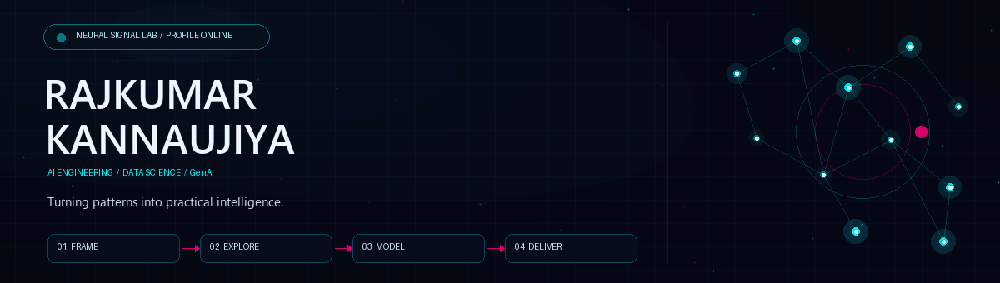
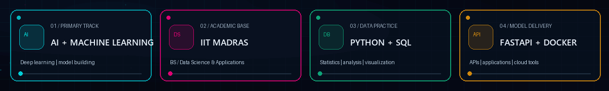
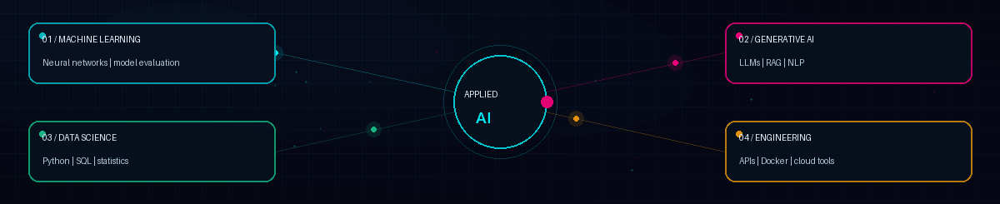
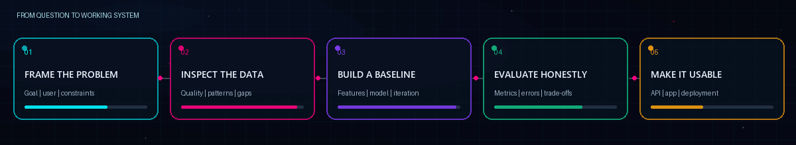
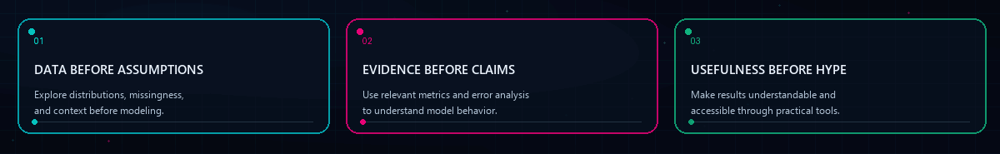

  
  
  
  

<h3>Applied AI · Machine Learning · Data Science</h3>

Surat, Gujarat, India &nbsp;·&nbsp; B.S. Data Science &amp; Applications at IIT Madras

## 👋 Profile

I’m Rajkumar Kannaujiya, pursuing a **B.S. in Data Science &amp; Applications at IIT Madras**. My focus is applied AI: understanding data, building and evaluating models, and turning useful ideas into practical software.

I’m especially interested in **machine learning, deep learning, generative AI, and language systems**—with a steady emphasis on reliable experiments and clear results.

## 🎓 IIT Madras

<table>
  <tr>
    <td width="62%" valign="top"><b>B.S. Data Science &amp; Applications</b> IIT Madras · 2024–2026</td>
    <td width="38%" valign="top"><b>Academic foundation</b> Mathematics · Statistics · Computing</td>
  </tr>
</table>

## 🧠 AI skill focus

<table>
  <tr>
    <td width="50%" valign="top"><b>Machine learning</b> Python · PyTorch · TensorFlow · Scikit-learn · neural networks · computer vision · model evaluation</td>
    <td width="50%" valign="top"><b>Generative AI &amp; language</b> LLMs · NLP · transformers · retrieval-augmented generation · vector search concepts</td>
  </tr>
  <tr>
    <td width="50%" valign="top"><b>Data science</b> SQL · PostgreSQL · Pandas · NumPy · statistics · exploratory analysis · visualization</td>
    <td width="50%" valign="top"><b>AI application delivery</b> FastAPI · Flask · Docker · REST APIs · Git · GitHub · Linux</td>
  </tr>
</table>

## ⚙️ How I approach AI

I work through a practical loop: define the problem, inspect the data, establish a baseline, evaluate results and trade-offs, then make the solution usable.

## 📊 GitHub activity

Live profile and contribution visualizations generated from GitHub activity.

<table>
  <tr>
    <td align="center" width="50%">
      
    </td>
    <td align="center" width="50%">
      
    </td>
  </tr>
  <tr>
    <td colspan="2" align="center">
      
    </td>
  </tr>
</table>

  

### 🐍 Contribution animation

  

Generated by the profile repository’s scheduled GitHub Actions workflow.

## ✨ Engineering principles

Sound baselines, honest evaluation, and clear communication make AI systems more useful.

## 🤝 Connect

Interested in AI, machine learning, or data products? [Connect on LinkedIn](https://www.linkedin.com/in/rajkumarkannaujiya) · [Email me](mailto:rajkumar.kannojiaa@gmail.com) · [Explore my repositories](https://github.com/RajkumarKannaujiya?tab=repositories)

