<picture>
  <source media="(prefers-color-scheme: dark)" srcset="./assets/pacman-hero-dark.svg">
  
</picture>

<b>Rajkumar Kannaujiya</b> · IIT Madras Student · Data Science &amp; Applied AI

<a href="mailto:rajkumar.kannojiaa@gmail.com">rajkumar.kannojiaa@gmail.com</a> &nbsp;·&nbsp; <a href="https://www.linkedin.com/in/rajkumarkannaujiya">LinkedIn</a>

**Player 1.** I’m pursuing the B.S. in Data Science and Applications at IIT Madras, building a strong foundation in statistics, machine learning, and data science. I use Python, scikit-learn, PyTorch, and generative AI tools to turn experiments into useful, responsible applications.

**Now playing:** Exploring LLM applications, practical AI workflows, and model evaluation through hands-on Python projects.

#### Scoreboard

<picture>
  <source media="(prefers-color-scheme: dark)" srcset="./assets/pacman-score-dark.svg">
  
</picture>

How to read the board

- **The maze is your year:** one column per week of the last 12 months and one row per weekday (Sunday on top), like the contribution calendar. Every day is a pellet, bigger and brighter on busier days; a faint dot is a day off.
- **Power pellets** are your busiest days. In the demo, the chomper eats its way to one of them and powers up.
- **The ghosts** are your featured repos, one each. Once it's powered up, the chomper eats them, and each one pops its stars before floating home to the pen.
- **The walls** are generated from your username and mirrored like an arcade board, so every board is different. The tunnel on Wednesdays wraps around.
- **HUD:** the score is your contributions over the year, alongside your best day, your longest streak, and your level: years on GitHub.
- **High scores** are your numbers, ranked the way an arcade ranks them. **Bonus items** are your languages by share of code.

Artwork: original animated SVG, generated by README Templates · template: Pacman. Motion stops if your system asks for reduced motion.

#### The ghosts

- **[northstar-job-agent](https://github.com/RajkumarKannaujiya/northstar-job-agent)** · AI job-search assistant for discovery, resume matching, and application tracking.  
  Python
- **[disease-prediction-ml](https://github.com/RajkumarKannaujiya/disease-prediction-ml)** · Academic ML demo with public benchmark datasets; educational, not a diagnostic tool.  
  Python

**Power-ups:** Python

<picture>
  <source media="(prefers-color-scheme: dark)" srcset="./assets/pacman-end-dark.svg">
  
</picture>

