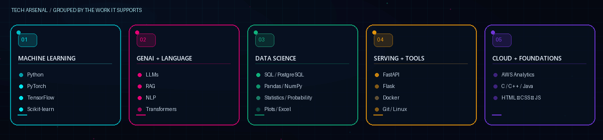
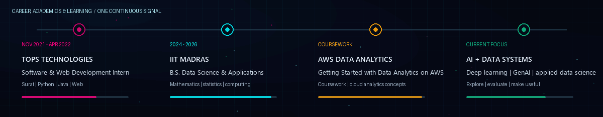

  
  
  
  

Surat, Gujarat, India &nbsp;·&nbsp; B.S. Data Science &amp; Applications, IIT Madras &nbsp;·&nbsp; AI Engineering + Data Science

## 👋 About me

I’m Rajkumar Kannaujiya, based in Surat, Gujarat. My background combines a B.S. program in Data Science &amp; Applications at IIT Madras (2024–2026) with an earlier Software &amp; Web Development internship at TOPS Technologies.

I’m building toward applied AI engineering: understanding a problem, working carefully with data, evaluating models, and making useful results accessible through software. My interests include machine learning, deep learning, generative AI, language systems, and data products.

## ⚡ How I build

I like a clear engineering loop: frame the question, inspect the data, establish a baseline, evaluate errors and trade-offs, then deliver the result in a usable form.

## 🧰 Technology map

  

<table>
  <tr>
    <td width="33%" valign="top"><b>Machine learning</b> Python · PyTorch · TensorFlow · Scikit-learn · neural networks · computer vision · model evaluation</td>
    <td width="33%" valign="top"><b>Generative AI &amp; language</b> LLMs · RAG · NLP · transformers · vector search concepts</td>
    <td width="33%" valign="top"><b>Data science</b> SQL · PostgreSQL · Pandas · NumPy · statistics · probability · Excel · Matplotlib · Seaborn</td>
  </tr>
  <tr>
    <td valign="top"><b>Application engineering</b> FastAPI · Flask · Docker · REST APIs · Git · GitHub · Linux · Bash</td>
    <td valign="top"><b>Cloud &amp; foundations</b> AWS analytics coursework · C · C++ · Java · HTML · CSS · JavaScript</td>
    <td valign="top"><b>Ways of working</b> EDA · feature preparation · baseline comparisons · error analysis · clear visualizations</td>
  </tr>
</table>

## 🧭 Experience &amp; learning

- **TOPS Technologies Pvt. Ltd.** — Software &amp; Web Development Intern, Surat · Nov 2021–Apr 2022
- **IIT Madras** — B.S. Data Science &amp; Applications · 2024–2026
- **AWS coursework** — “Getting Started with Data Analytics on AWS” (coursework)

## 📊 GitHub activity

Live profile and contribution visualizations generated from GitHub activity.

<table>
  <tr>
    <td align="center" width="50%">
      
    </td>
    <td align="center" width="50%">
      
    </td>
  </tr>
  <tr>
    <td colspan="2" align="center">
      
    </td>
  </tr>
</table>

  

### 🐍 Contribution animation

  

Generated by the profile repository’s scheduled GitHub Actions workflow.

## ✨ Engineering principles

I value sound baselines, honest evaluation, and clear communication. A model is only one part of a useful system.

## 🤝 Connect

Interested in AI, data products, or practical engineering? [Connect on LinkedIn](https://www.linkedin.com/in/rajkumarkannaujiya) · [Email me](mailto:rajkumar.kannojiaa@gmail.com) · [Explore my repositories](https://github.com/RajkumarKannaujiya?tab=repositories)

